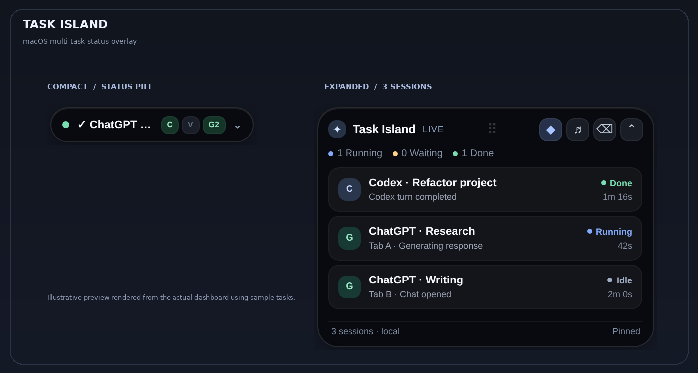
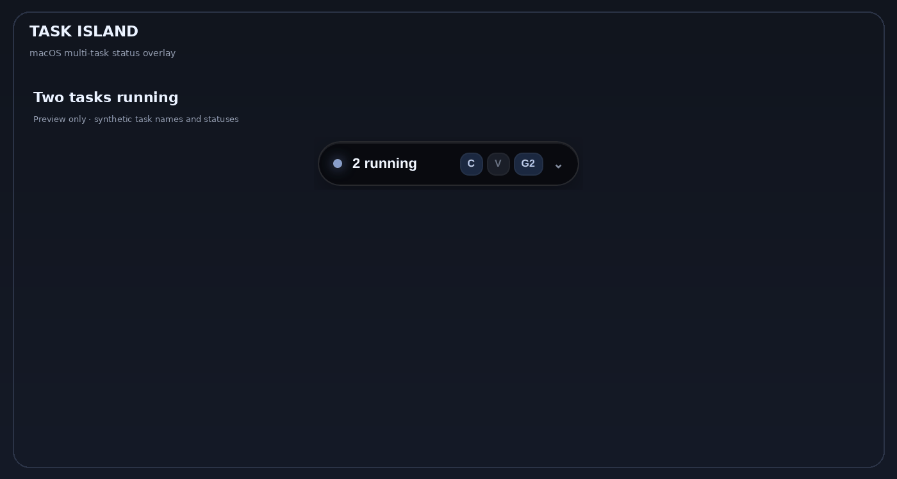

# ✦ Task Island

**A free, local-first multi-task island for macOS.** Track ChatGPT browser tabs, Codex turns (where hooks are supported), and VS Code task/terminal activity in one compact desktop overlay.

> **Community prototype — not affiliated with OpenAI, ChatGPT, Codex, Apple, or Hammerspoon.** The overlay is a floating window, *not* a native macOS notch replacement. Features were code-tested; macOS compatibility depends on your setup.

[**Download v0.5.0-beta**](https://github.com/xinning516/task-island/releases/download/v0.5.0-beta/Task-Island-v0.5.0-beta.1.zip) · [Releases](https://github.com/xinning516/task-island/releases)



**Animated demo** — expand, track multiple sessions, and see completion status:



*Both visuals are rendered using this repository's real dashboard HTML with **simulated example tasks**. They are not recordings of a user's desktop or real AI sessions.*


## Features

- 🏝️ **Compact pill:** ~210 × 41 px, optional 168 px mode, expands on hover or click.
- 🧩 **Multi-task view:** Separate ChatGPT tabs, Codex sessions, and VS Code activities with running / waiting / done / error / idle indicators.
- 🖐️ **Drag to reposition:** Drag from the expanded header grip; location persists between Hammerspoon reloads (multi-display best-effort).
- 🎚️ **Background opacity:** 40–100% from the `◉` menubar menu, remembered across relaunches.
- 🔔 **Optional sounds:** Task completions, errors, and approval prompts.
- 👁️ **Per-source visibility:** Hide VS Code without uninstalling; turn it back on when needed.
- 🔒 **Local communication:** Browser, editor and hooks send short status events to an authenticated loopback HTTP service (`127.0.0.1:47839`). No paid API or cloud backend.

## Requirements

- macOS and [Hammerspoon](https://www.hammerspoon.org/) (free)
- Python 3 to run the installer and Codex hook
- Google Chrome for **ChatGPT website tracking** (not ChatGPT Desktop)
- Optional: VS Code; Codex with compatible lifecycle hooks

You do **not** need Homebrew. Download Hammerspoon from its official website if `brew` is unavailable.

## Download and install

Download the [v0.5.0-beta ZIP](https://github.com/xinning516/task-island/releases/download/v0.5.0-beta/Task-Island-v0.5.0-beta.1.zip), or use GitHub's **Code → Download ZIP**. The archive contains source code and an installer, not a signed `.app`; Hammerspoon is required.


1. Download or clone this repository, then inspect the install script before running it.
2. Install and open Hammerspoon.
3. In Terminal, run from the repository directory:

   ```sh
   python3 integrations/install.py
   ```

4. In Hammerspoon's menu, choose **Reload Config**. A `◉` menu and the compact island should appear.
5. Open `chrome://extensions`, enable **Developer mode**, choose **Load unpacked**, and select **`~/TaskIsland-Chrome-Extension`**. Refresh already-open `https://chatgpt.com/` tabs. In the extension popup, use **Check this ChatGPT tab** to test real-page tracking.
6. Optional: restart VS Code, and restart Codex / review any new hooks it offers to load.

**Note:** The installer writes an independent random local token to `~/.hammerspoon/task-island/token.txt`, then inserts that token into the **installed** Chrome/VS Code integrations. Never publish those generated files. Your existing Hammerspoon `init.lua` and Codex `hooks.json` are backed up before being merged. The installer *does* update the Task Island app and installed extensions if you run it again; review local customizations first.

### macOS file permissions

If Terminal cannot read an installer run from `Downloads`, move the repository to a directory Terminal can access, or grant the applicable Files & Folders permission in **System Settings → Privacy & Security**. Do not globally disable Gatekeeper or use `sudo` to bypass it.

## Everyday use

- Hover to expand; move away to collapse. Click the pill to pin/unpin the expanded view.
- Use the center blank area of the expanded header to drag the island.
- In the menubar `◉` menu: **Show VS Code**, **Extra-small pill**, **Island opacity**, **Expand on hover**, **Reset island position**, **Mute sounds**, and demo tasks.
- Shortcut: **Control + Option + Command + I**.

## Integration support and limitations

| Source | What it observes | Limitations |
| --- | --- | --- |
| ChatGPT on Chrome | Each open ChatGPT tab; submit/Stop control changes; inferred running/finished/idle | Best-effort DOM tracking. Site updates may break it. No native ChatGPT app support. A status is not a model-internal progress percentage. |
| Codex | Lifecycle hook events (submit, post-tool, permission request, stop, interrupt) for versions that invoke the configured hooks | Codex Desktop/CLI hook compatibility varies; not an official integration and not verified on every release. |
| VS Code | Tasks and shell-integrated terminal commands | Does not read generic AI-extension “thinking” state; terminal events require shell integration and compatible VS Code. Unknown task exit codes show **Idle/Unknown**, never a false Done. |

Task names may include a **ChatGPT tab's page title** or **Codex's working-directory basename**. The extension does *not* send prompt or answer bodies to the island. VS Code terminal command arguments are deliberately not sent. Events stay in memory, except UI preferences and a randomly generated local authentication token.

## Privacy and security

This repository deliberately **does not include** generated secrets, browser history, user projects, or screenshots of private chats. Do not copy installed `config.js`, `config.json`, or `token.txt` into this repository. A `.gitignore` blocks those filenames, but *review `git status` before pushing*.

The local server binds to `127.0.0.1` and checks an `X-Island-Key` header for task updates. Treat it as a local desktop tool, not a network-facing service; never forward port `47839` to the internet. The `/health` endpoint does not require authentication. The UI stores no prompt/answer text, but tab and task titles can still be sensitive when displayed on screen.

## Project files

```text
chrome-extension/           # ChatGPT Chrome content script + local status sender
hammerspoon/                # compact/draggable/opacity island UI & server
integrations/codex_hook.py  # Codex hook
integrations/install.py     # local installer (generates unique keys)
vscode-extension/           # local VS Code monitor
install.command             # Finder-friendly macOS wrapper (Terminal command also works)
tests/                      # installer / static smoke checks
```

## Tests

```sh
python3 -m unittest discover -s tests -v
```

macOS-specific Hammerspoon behavior requires testing on macOS with permissions enabled. Browser status detection is inherently subject to ChatGPT UI updates.

## Contributing and license

Bug reports and contributions welcome. CI runs Python and JavaScript tests plus Lua syntax on both Linux and macOS; a real Mac is still required for interactive Accessibility and window-drag testing. Licensed under **MIT**; see [LICENSE](LICENSE). If you are republishing or forking this prototype, make sure you have rights to all code you add and follow each dependency's license. Do not claim official affiliation with the services it tracks.
